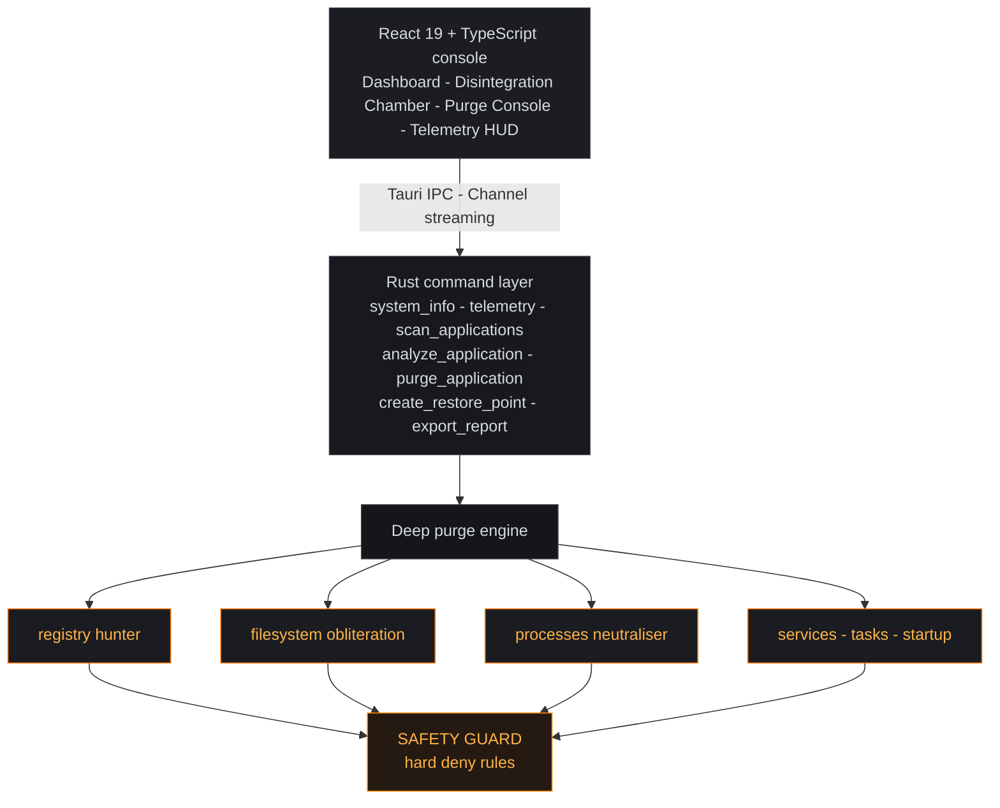

# DISINTEGRATOR

### Premium ultra-deep uninstaller for Windows 11 - forensic-grade residue elimination

[](https://github.com/IBranch029/Haydee-Disintegrator/releases)
[](https://github.com/IBranch029/Haydee-Disintegrator/releases)
[](LICENSE)
[](https://www.microsoft.com/en-us/windows/windows-11-specifications)
[](https://www.rust-lang.org)
[](https://tauri.app)
[](https://www.typescriptlang.org)

> **DISINTEGRATOR** does not "uninstall" software. It **dissects** it: registry
> trees, scattered payloads, kernel services, scheduled tasks, autostart hooks
> and driver registrations are hunted down and vaporised, leaving nothing but
> an inert operating system.

```text
  ██████╗ ██╗███████╗██╗███╗   ██╗ ████████╗ ██████╗ ██████╗
  ██╔══██╗██║██╔════╝██║████╗  ██║ ╚══██╔══╝██╔════╝██╔═══██╗
  ██║  ██║██║█████╗  ██║██╔██╗ ██║    ██║   ██║     ██║   ██║
  ██║  ██║██║██╔══╝  ██║██║╚██╗██║    ██║   ██║     ██║   ██║
  ██████╔╝██║███████╗██║██║ ╚████║    ██║   ╚██████╗╚██████╔╝
  ╚═════╝ ╚═╝╚══════╝╚═╝╚═╝  ╚═══╝    ╚═╝    ╚═════╝ ╚═════╝
   D E E P   P U R G E   C O N S O L E   ·   H A Y D E E - 1
```

---

## Mission

A classic uninstaller removes what its vendor script knows about. Everything
else - a driver left in `SYSTEM\CurrentControlSet\Services`, a scheduled task
that re-registers the updater at every boot, an orphaned `HKCR\CLSID` shell
extension, a 4 GB payload in `%LOCALAPPDATA%` - **survives**.

DISINTEGRATOR performs a five phase forensic sweep and destroys every artefact
that can be attributed to the target, while a hard **safety guard** refuses to
touch the operating system itself.

### Capabilities

| Phase | What it dissolves |
|---|---|
| **Registry Hunter** | BFS traversal of `HKLM/HKCU\SOFTWARE`, `WOW6432Node`, `HKCR` (CLSID, ProgID, shell extensions, file associations), `HKLM\SYSTEM\CurrentControlSet\Services`, uninstall hives, `Run`/`RunOnce` autostart values |
| **Filesystem Obliteration** | `Program Files`, `Program Files (x86)`, `ProgramData`, `AppData\Local/Roaming/LocalLow`, `Saved Games`, `Temp`, `Prefetch`, `CrashDumps`, Start Menu entries, nested payload directories |
| **Service & Driver Scrub** | SCM enumeration via the language independent `Services` registry hive, service stop and delete, kernel driver registration removal |
| **Task Scheduler Purge** | Scheduled tasks whose actions reference the target, removed through the Task Scheduler |
| **Process Neutralisation** | Toolhelp32 snapshot, process tree resolution, forced termination of parents **and** descendants |
| **Safety First** | Hard guard protecting `C:\Windows`, `System32`, `WindowsApps`, `Common Files\Microsoft Shared`, the MSI cache, shared runtimes (VC++, DirectX, .NET, Python) and every critical Windows service |

### Safety guarantees

1. **Every destructive call passes the guard.** `SafetyGuard::check_path`,
   `check_service`, `check_registry_key` and `check_registry_value` are the
   only gateways to the filesystem, SCM and registry APIs.
2. **Subtree protection** - nothing under `C:\Windows`, `WindowsApps`,
   `Common Files\Microsoft Shared` or the installer cache is ever reachable.
3. **Ancestor protection** - deleting `C:\`, `C:\Users` or `SOFTWARE` is
   rejected because it would take a protected artefact with it.
4. **Shared runtime protection** - `vcruntime140.dll`, `msvcp140.dll`,
   `d3dcompiler_47.dll`, `ucrtbase.dll`, `python312.dll` and friends are
   classified as shared components and survive every purge.
5. **Service ownership** - a service whose binary lives inside `%SystemRoot%`
   is owned by the operating system and can never be deleted.
6. **Restore point first** - a system restore point is created through
   `SRSetRestorePointW` (with a `Checkpoint-Computer` fallback) before the
   first destructive action.
7. **Read only by default** - the *Disintegration Chamber* shows every
   artefact that will be touched, including the ones the guard protects.

---

## Architecture



Every destructive call passes through the **safety guard** - the single choke
point between the engine and the operating system.

### Module map

| Module | Responsibility |
|---|---|
| `engine/safety.rs` | Heuristic guard: subtree, exact and ancestor protection, shared runtime classification, protected registry keys, protected services |
| `engine/registry.rs` | Uninstall inventory, budgeted BFS residue scan, key tree and value deletion |
| `engine/filesystem.rs` | Recursive obliteration, reparse point unlinking, attribute clearing, ownership takeover, `MOVEFILE_DELAY_UNTIL_REBOOT` deferral |
| `engine/processes.rs` | Toolhelp32 snapshot, image path resolution, process tree termination |
| `engine/services.rs` | Service Control Manager integration, service and driver stop and delete |
| `engine/tasks.rs` | Scheduled task enumeration and removal (language independent JSON bridge) |
| `engine/startup.rs` | `Run`/`RunOnce` values and Startup folder shortcuts |
| `engine/apps.rs` | Application inventory (registry and MSIX), architecture detection |
| `engine/residue.rs` | Deep inspection aggregating every residue source and scoring the threat |
| `engine/purge.rs` | Ordered destruction pipeline with realtime event streaming |
| `engine/restore.rs` | `SRSetRestorePointW` checkpoint creation |
| `engine/sysinfo.rs` | CPU, memory and disk telemetry, elevation detection |
| `cli.rs` | Headless command line interface |
| `commands.rs` | Tauri command surface consumed by the frontend |

---

## Installation

### Release artefacts

| Artefact | Description |
|---|---|
| `Disintegrator_v1.0.1_x64.exe` | Single file portable executable - run it from anywhere |
| `Disintegrator_v1.0.1_x64-setup.exe` | NSIS installer with Start Menu and desktop shortcuts |
| `SHA256SUMS.txt` | Cryptographic checksums of every artefact |

> The executable embeds a `requireAdministrator` manifest: Windows raises a UAC
> prompt on launch. The engine **cannot** scrub `HKLM`, stop services or remove
> system drivers without elevation.

### Build from source

```powershell
# Prerequisites
winget install Rustlang.Rustup
winget install OpenJS.NodeJS.LTS
winget install Microsoft.VisualStudio.2022.BuildTools --override "--add Microsoft.VisualStudio.Workload.VCTools --includeRecommended"

# Build
git clone https://github.com/IBranch029/Haydee-Disintegrator.git
cd Haydee-Disintegrator
npm install
npm run tauri:build
```

Artefacts are written to `src-tauri/target/release/bundle/nsis/`.

---

## Command line interface

```text
DISINTEGRATOR v1.0.1
Premium ultra-deep uninstaller for Windows 11

TARGETING:
    --scan                     List every installed application
    --analyze <TARGET>         Deep inspection without destroying anything
    --purge <TARGET>           Execute the full purge pipeline

EXECUTION:
    --no-restore-point         Skip the system restore point creation
    --no-uninstaller           Do not invoke the vendor uninstaller
    --no-services              Keep Windows service registrations
    --no-tasks                 Keep scheduled tasks
    --no-startup               Keep autostart hooks
    --no-reboot-deferral       Fail instead of deferring locked files

OUTPUT:
    --json                     Emit machine readable JSON
    --version, -V              Print the version banner
    --help, -h                 Print this banner
```

Examples:

```powershell
disintegrator.exe --scan
disintegrator.exe --analyze "Contoso Suite"
disintegrator.exe --purge "Contoso Suite" --no-restore-point
```

---

## Testing

```powershell
npm run typecheck        # TypeScript strictness
npm test                 # Frontend unit tests (Vitest)
cd src-tauri
cargo test               # Rust unit tests and the end-to-end dissolution test
```

The end-to-end test (`src-tauri/tests/e2e_dummy.rs`) generates a **complete
dummy application** on the live machine - nested payload directories, a
registry tree, an installer registration, an autostart hook, a Windows service
and a scheduled task - runs the production purge pipeline against it and
asserts that **100 %** of the generated artefacts are dissolved. Service and
task assertions are skipped automatically when the test host is not elevated.

Safety regressions are covered by dedicated unit tests: attempting to purge
`C:\Windows\System32`, `SysWOW64`, `WindowsApps`, an ancestor of a protected
location, a shared runtime DLL or a critical Windows service must be rejected.

Current status: **34 Rust unit tests**, **1 end-to-end dissolution test** and
**9 frontend tests** - all green.

---

## Project structure

```text
Haydee-Disintegrator/
├── assets/disintegrator.svg      # Application emblem
├── scripts/collect-release.ps1   # Release artefact staging and checksums
├── src/                          # React 19 + TypeScript console
│   ├── components/               # TopBar, Dashboard, Chamber, PurgeConsole, ParticleField
│   ├── lib/                      # Typed IPC bridge and formatters
│   ├── styles/                   # Haydee-1 design tokens and layout
│   └── types.ts                  # Contract mirroring the Rust models
├── src-tauri/
│   ├── assets/                   # Windows application manifest (requireAdministrator)
│   ├── capabilities/             # Tauri capability set
│   ├── icons/                    # Generated icon set
│   ├── src/
│   │   ├── cli.rs                # Headless command line interface
│   │   ├── commands.rs           # Tauri command surface
│   │   ├── engine/               # The deep purge engine
│   │   ├── error.rs              # Error taxonomy
│   │   ├── lib.rs                # Application bootstrap
│   │   └── model.rs              # Serialisable data contract
│   └── tests/e2e_dummy.rs        # End-to-end dissolution test
└── .github/workflows/            # CI and release automation
```

---

## Disclaimer

DISINTEGRATOR performs irreversible system modifications. It ships with a
heuristic safety guard, but no uninstaller can guarantee the absence of edge
cases on a modified or hostile system. Always create a restore point or a
system image before a deep purge, and never run it against a machine whose
only copy of the data lives inside the target application.

## License

Licensed under the [Apache License 2.0](LICENSE).

```text
Copyright 2026 IBranch029
```

